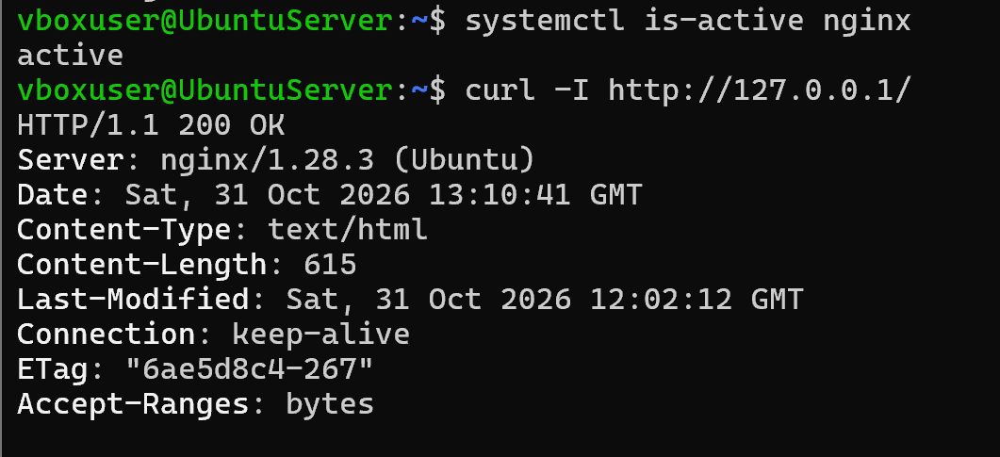
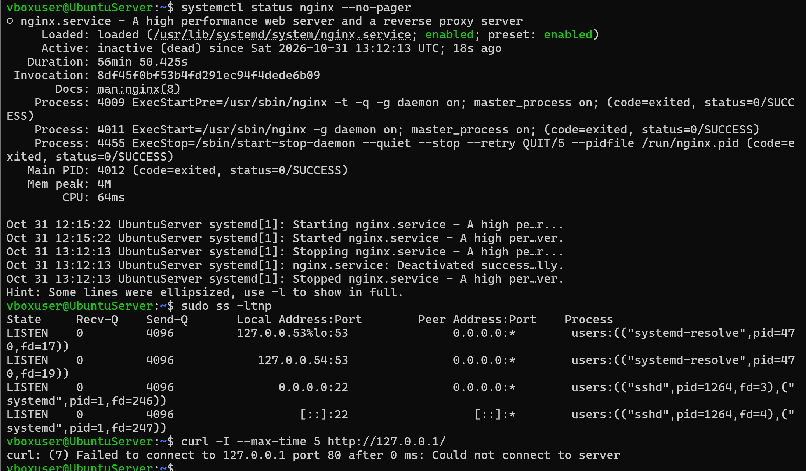
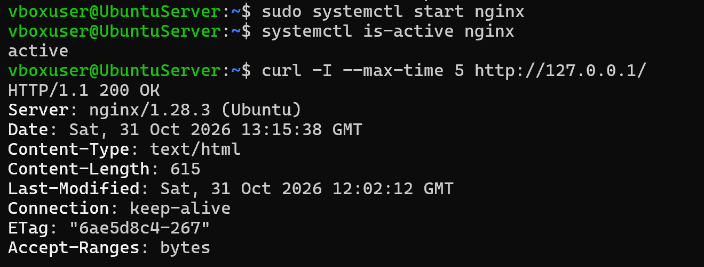

# Nginx: диагностика остановленной службы и восстановление HTTP

Учебная лабораторная работа по диагностике службы Linux: проверка состояния Nginx, слушающих TCP-портов и HTTP-ответа, запуск службы и проверка результата.

## Окружение и доказательства

- Терминал Ubuntu, узел `UbuntuServer`.
- Адрес проверки: `http://127.0.0.1/` — локальный HTTP-сервис на порту 80.
- HTTP-заголовок сервера: `nginx/1.28.3 (Ubuntu)`.
- Доказательства: три скриншота терминала, приведённые ниже.

Время на скриншотах относится к часам виртуальной машины: 31 октября 2026 года. Фактическая календарная дата выполнения отдельно не подтверждена.

## 1. Исходное рабочее состояние

Выполненные команды:

```bash
systemctl is-active nginx
curl -I http://127.0.0.1/
```

Результаты: состояние `active`, HTTP-ответ `HTTP/1.1 200 OK`.



## 2. Диагностика недоступности

Выполненные команды:

```bash
systemctl status nginx --no-pager
sudo ss -ltnp
curl -I --max-time 5 http://127.0.0.1/
```

Подтверждённые наблюдения:

| Проверка | Результат |
| --- | --- |
| Состояние службы | `inactive (dead)` |
| Наличие unit-файла | `nginx.service` загружен, автозапуск включён (`enabled`) |
| События в выводе `systemctl status` | `Stopping`, `Deactivated successfully`, `Stopped` |
| Завершение основного процесса | `status=0/SUCCESS` |
| Слушающие TCP-порты | В показанном выводе `ss` отсутствует порт 80; видны порты 53 и 22 |
| Локальный HTTP-запрос | `curl: (7) Failed to connect to 127.0.0.1 port 80` |

Вывод: в момент проверки Nginx был остановлен, а на локальном TCP-порту 80 не было слушателя. Это объясняет отказ подключения. Показанные записи говорят о штатной остановке; кто и почему остановил службу, по этим данным установить нельзя. Включённый автозапуск (`enabled`) не означает, что служба работает сейчас.



## 3. Восстановление и повторная проверка

Выполненные команды:

```bash
sudo systemctl start nginx
systemctl is-active nginx
curl -I --max-time 5 http://127.0.0.1/
```

После запуска:

- `systemctl is-active nginx` вернул `active`.
- Локальный HTTP-запрос вернул `HTTP/1.1 200 OK`.
- В ответе присутствует заголовок `Server: nginx/1.28.3 (Ubuntu)`.



## Итог

Восстановлена обработка локальных HTTP-запросов после запуска остановленной службы Nginx. Результат подтверждён состоянием `active` и ответом `200 OK`.

В работе показана последовательность диагностики: состояние службы → слушающие порты → HTTP-запрос → запуск службы → повторный HTTP-запрос. Журнальные события прочитаны в выводе `systemctl status`; отдельного вывода `journalctl` среди предоставленных материалов нет.

Проверки выполнялись через `127.0.0.1`. Доступность с другого компьютера, настройки сетевого экрана и причина первоначальной остановки этими скриншотами не подтверждены.
