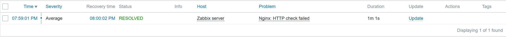
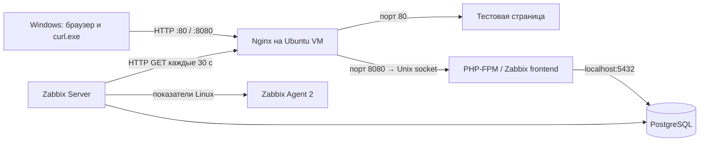

# Мониторинг Ubuntu Server через Zabbix

Практический проект для портфолио **IT Support L1–L2**: установка Zabbix, проверка метрик Linux, диагностика ошибок и эксперимент с остановкой и восстановлением Nginx.

**Практика выполнена 13 ноября 2026 года на Ubuntu Server пользователя в VirtualBox.** Команды выполнял пользователь; результаты подтверждены выводами и скриншотами. Данные симуляции INC-001 сюда не переносились.

## Результат

- Zabbix Server и веб-интерфейс **7.0.32** работают с PostgreSQL **18** и PHP **8.5**.
- Поступают CPU, RAM и показатели корневой файловой системы; RAM и диск сопоставлены с командами Ubuntu.
- HTTP-сценарий проверяет сайт Nginx каждые **30 секунд**, ожидая **200 OK**.
- При остановке Nginx возникло событие, после запуска оно автоматически закрылось: **RESOLVED**, длительность по Zabbix **1 минута 1 секунда**.
- После перезагрузки проверены автозапуск служб, база, синхронизация часов и свежие HTTP/CPU-данные.
- Внешние уведомления по решению пользователя **не настраивались**.

## Стенд

| Компонент | Фактическая конфигурация |
|---|---|
| Гостевая ОС | Ubuntu Server 26.04.1 LTS, amd64 |
| Виртуализация | VirtualBox |
| Ресурсы VM после подготовки | 2 vCPU, 4096 МБ RAM, swap отсутствует |
| Память, видимая ОС | около 3,3 GiB; 512 MiB выделено под crashkernel |
| Корневая ФС | ext4, /dev/sda2; около 24,44 GiB |
| IP во время практики | 192.168.1.53/24, интерфейс enp0s3 |
| Тестовый сайт | http://192.168.1.53/ — порт 80 |
| Веб-интерфейс | http://192.168.1.53:8080/ |
| База | PostgreSQL 18/main, порт 5432; база и роль zabbix |
| Сбор данных | Zabbix Agent 2, хост в Zabbix: Zabbix server |
| Время | Ubuntu — UTC; веб-интерфейс — Europe/Moscow |
| Точка возврата | снимок Before-Zabbix, создан пользователем до установки |

Версии ядра, пакетов и ОС относятся к моменту практики. Способ назначения IP и режим сети VirtualBox отдельно не зафиксированы; доступ Windows → VM подтверждён ping и HTTP. Перед повторением следует проверить актуальные версии и адрес своей VM.

## Схема

Сервер мониторинга и наблюдаемый сайт размещены на одной VM. Остановка Nginx отключает также веб-интерфейс, но не Zabbix Server. История события проверена после восстановления. Выключение всей VM извне этот стенд не обнаруживает.

## Документация

1. [Установка и настройка](docs/installation.md) — последовательность действий, роль компонентов, безопасный ввод паролей.
2. [Проверки и эксперимент с Nginx](docs/validation.md) — метрики, триггер, сбой, восстановление и перезагрузка.
3. [Troubleshooting](docs/troubleshooting.md) — реальные проблемы и ход диагностики.
4. [Результаты и скриншоты](evidence/README.md) — подтверждения и пределы выводов.
5. [Примеры конфигурации](configs/README.md) — настройки без учётных данных.

## Чему посвящён проект

Диагностика служб через systemctl и журналы, работа с пакетами APT, основы PostgreSQL, взаимодействие Nginx и PHP-FPM, чтение метрик и графиков, настройка HTTP-проверок и триггеров, проверка восстановления и документирование результатов.

## Ограничения

- Проверка ожидает код 200, но не проверяет текст страницы, авторизацию или бизнес-функции приложения.
- Длительность события отражает интервальные проверки, а не точное время остановки процесса.
- 11 метрик необязательных компонентов остались Not supported; причины описаны в troubleshooting. Они не скрыты и не представлены как исправленные.
- Стенд учебный: HTTP без HTTPS на локальном адресе; база и мониторинг находятся на той же VM. Нагрузочное тестирование не проводилось.
- Запас памяти оценён по текущим измерениям, а не как гарантия для производственной нагрузки.
- Пароли, токены, cookies, публичный IP и действующие конфиги с секретами не публикуются. Снимок VM не заменяет резервную копию.

## Источники

- [Установка из пакетов Zabbix 7.0](https://www.zabbix.com/documentation/7.0/en/manual/installation/install_from_packages)
- [Требования Zabbix 7.0](https://www.zabbix.com/documentation/7.0/en/manual/installation/requirements)
- [Метрики веб-сценариев](https://www.zabbix.com/documentation/7.0/en/manual/web_monitoring/items)
- [Жизненный цикл версий](https://www.zabbix.com/life_cycle_and_release_policy)
- [Диагностика chrony](https://chrony-project.org/doc/latest/chronyc.html)
