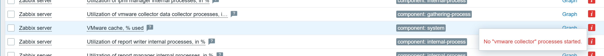

# Troubleshooting по фактической практике

## 1. curl в Windows вызвал Invoke-WebRequest

**Симптом:** PowerShell сообщает, что не найден позиционный параметр для --max-time; в ошибке указан Invoke-WebRequest.

**Причина:** в использованной сессии Windows PowerShell имя curl разрешалось в Invoke-WebRequest с другим набором аргументов.

**Решение:** команды для Ubuntu выполнять в терминале VM; для Windows явно вызывать curl.exe.

```powershell
curl.exe -I --connect-timeout 5 --max-time 15 http://192.168.1.53/
```

**Повторная проверка:** получен HTTP/1.1 200 OK от Nginx. Первая ошибка параметров не была доказательством сетевой неисправности.

## 2. HTTPS: certificate is not yet valid

**Симптом:** curl (60), certificate is not yet valid при обращении из Ubuntu к https://www.zabbix.com.

**Диагностика:**

```bash
timedatectl
timedatectl timesync-status
systemctl status chrony.service systemd-timesyncd.service --no-pager
chronyc tracking
```

Фактические наблюдения:

- VM показывала 31 октября 2026, фактическая дата практики — 13 ноября 2026.
- NTP service active, но System clock synchronized: no.
- timesync-status сообщил, что systemd-timesyncd недоступен.
- Служба chrony была active; отсутствие timesyncd не означало отсутствия NTP-клиента.
- chronyc tracking: Ref time 13 ноября 2026; System time 1118765.25 seconds slow of NTP time, Leap status Normal.

**Причина ошибки HTTPS:** большая ошибка системных часов. Причина первоначального сдвига часов VM не установлена; её нельзя уверенно приписать VirtualBox, сохранённому состоянию или серверу NTP.

**Исправление на учебном стенде:**

```bash
sudo chronyc makestep
```

Команда вернула 200 OK и скачком применила рассчитанную поправку. Это не HTTP-код, а ответ chronyc. Резкий перевод времени может влиять на приложения; здесь он выполнен до установки Zabbix.

**Повторные проверки:**

```bash
chronyc tracking
timedatectl
curl -I --connect-timeout 5 --max-time 15 https://www.zabbix.com
```

Сначала оставшаяся поправка стала практически нулевой, затем synchronized: yes; RTC и системное время совпали. HTTPS вернул HTTP/2 200. После reboot синхронизация сохранилась.

Большое старое RMS offset не означало, что текущие часы всё ещё отстают на столько же. Значение порядка наносекунды в System time — оценка оставшейся поправки, а не доказательство абсолютной наносекундной точности.

Проверка сертификата не отключалась. В отчёт не включены cookies и публичный IP из HTTP-заголовков.

## 3. Выделено 4 GiB, Ubuntu показывает около 3,3 GiB

**Диагностика:**

```bash
sudo dmesg | grep -i 'Memory:'
cat /proc/cmdline
cat /sys/kernel/kexec_crash_size
```

- Ядро обнаружило 4193848K — около 4 GiB.
- В параметрах ядра есть crashkernel с диапазонами резервирования.
- kexec_crash_size: 536870912 байт, то есть 512 MiB.

**Вывод:** VM получила заданную память; значительная часть разницы объясняется резервом crashkernel, оставшаяся — другими резервами и потреблением ядра. Ранняя строка dmesg с 2742876K reserved не является окончательным резервом после загрузки.

**Действие:** резерв не отключался. После установки available в Ubuntu составляла около 2,5Gi, в Zabbix 2,51 GB. Достаточность под длительной нагрузкой отдельно не доказана.

## 4. 11 элементов Not supported

**Симптом:** в Latest data у Zabbix server 11 неподдерживаемых внутренних метрик.

**Диагностика:** фильтр State: Not supported, текст красного значка Info, сопоставление с /var/log/zabbix/zabbix_server.log.

Список относится к:

- Connector queue, connector manager, connector worker — 3 элемента.
- IPMI poller и IPMI manager — 2.
- Java poller — 1.
- SNMP trapper — 1.
- VMware collector и VMware cache — 2.
- Report writer и report manager — 2.

Подсказка VMware cache: No "vmware collector" processes started. В журнале соответствующие сообщения о незапущенных процессах, а для connector queue — просьба проверить StartConnectors.

**Причина:** шаблон содержит метрики необязательных компонентов, которые в данном стенде не запускались. VMware collector предназначен для VMware, а не VirtualBox.

**Действие:** компоненты не включали только ради внутренних метрик; элементы не удаляли и не скрывали. Для мониторинга CPU, RAM, диска и HTTP они не требуются. Их статус оставлен как известное ограничение. Если функциональность понадобится, её настраивают отдельно и затем проверяют эти метрики.



## 5. Краткая ошибка агента при запуске

В журнале:

```text
16:26:06 — system.cpu.util[,steal]: first network error
16:26:21 — resuming Zabbix agent checks: connection restored
```

Связь восстановилась. CPU, RAM и диск позднее имели свежие значения, после reboot свежесть CPU подтверждена снова.

Причина одиночного прерывания не установлена. Отдельное исправление не выполнялось; утверждать, что это был конкретный дефект сети или конфигурации, нельзя. При повторении следует проверять состояние агента, его журнал и параметры доступа.

## 6. Latest data показывает только неподдерживаемые компоненты

**Наблюдение:** после reboot вместо CPU был прислан список прежних 11 элементов.

**Действие:** выбраны State: All, Name: CPU utilization, затем Apply.

**Результат:** CPU 7,2308%, Last check 16s. Старый фильтр может скрывать нужные метрики и не является сам по себе сбоем сбора данных.

## 7. Веб-интерфейс недоступен во время остановки Nginx

Это ожидаемое поведение общей архитектуры: один Nginx обслуживает и сайт :80, и интерфейс :8080. После start nginx оба могут снова принимать запросы. Событие проверено в History после восстановления.

Если возвращение страницы не произошло, следующие команды пригодны для дальнейшей диагностики, но дополнительные неисправности ими в этой практике не воспроизводились:

```bash
systemctl status nginx php8.5-fpm --no-pager -l
sudo nginx -t
sudo ls -l /var/run/php/zabbix.sock
sudo tail -n 50 /var/log/nginx/error.log
```

При просмотре действующих конфигов нельзя передавать в отчёт DBPassword и другие секреты.

## Источник по времени

[chronyc: tracking и makestep](https://chrony-project.org/doc/latest/chronyc.html).
