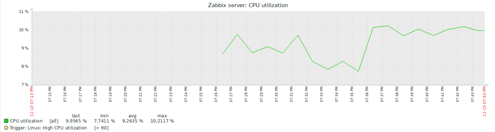
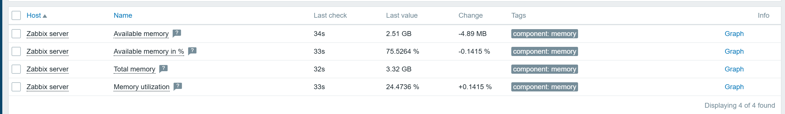
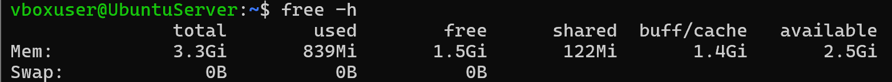
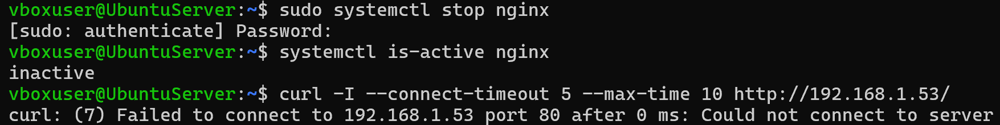
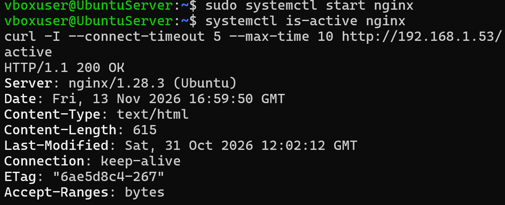
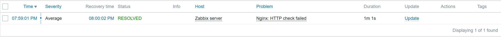
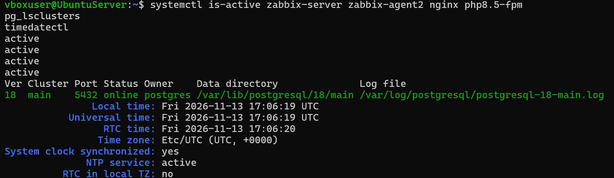
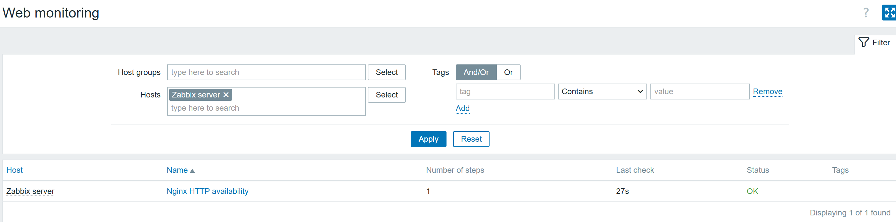
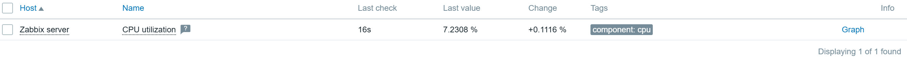

# Результаты и скриншоты

Источник: скриншоты, присланные пользователем в ходе практики 13 ноября 2026 года. Они скопированы без изменения изображения и получили понятные имена. Это подтверждения отдельных состояний, а не непрерывная запись эксперимента.

Пароли и токены в выбранных изображениях не отображаются. Скриншоты показывают локальные имя пользователя, hostname и частный IP учебного стенда; заголовки с публичным IP и cookies не включены. Экраны ввода паролей не включены даже с маскировкой.

## Сбор метрик

| Файл | Что подтверждает |
|---|---|
| [01-cpu-history.png](screenshots/01-cpu-history.png) | график CPU, диапазон 7,74–10,21%, среднее 9,26% по имеющимся точкам |
| [02-memory-zabbix.png](screenshots/02-memory-zabbix.png) | total 3,32 GB, available 2,51 GB, utilization 24,47% |
| [03-memory-terminal.png](screenshots/03-memory-terminal.png) | free -h: total 3,3Gi, available 2,5Gi, swap 0 |
| [04-disk-zabbix.png](screenshots/04-disk-zabbix.png) | пространство и inode корневой ФС, read-only = 0 |
| [05-disk-terminal.png](screenshots/05-disk-terminal.png) | df -h / и df -i / для сравнения |

## Диагностика и HTTP-проверка

| Файл | Что подтверждает |
|---|---|
| [06-unsupported-vmware.png](screenshots/06-unsupported-vmware.png) | причина Not supported: процесс VMware collector не запущен |
| [07-web-step.png](screenshots/07-web-step.png) | URL, тайм-аут 5s, код 200; шаг виден в ещё не сохранённой форме сценария |
| [08-web-before-outage.png](screenshots/08-web-before-outage.png) | сохранённый сценарий работает: OK, Last check 10s |

Полная конфигурация триггера не представлена отдельным заполненным скриншотом или экспортом. Настройка описана по выполненным шагам; её результат подтверждён реальным событием.

## Сбой и восстановление Nginx

| Файл | Что подтверждает |
|---|---|
| [09-nginx-stopped.png](screenshots/09-nginx-stopped.png) | stop nginx, inactive и ошибка curl (7) |
| [10-nginx-restored.png](screenshots/10-nginx-restored.png) | start nginx, active и HTTP 200 |
| [11-event-resolved.png](screenshots/11-event-resolved.png) | событие Average, 19:59:01 → 20:00:02 по Москве, RESOLVED, длительность 1m 1s |

61 секунда — длительность события по данным Zabbix, не измерение точной длительности остановки процесса. Во время сбоя веб-интерфейс также был недоступен, поэтому событие просмотрено после восстановления.

## Проверка перезагрузкой

| Файл | Что подтверждает |
|---|---|
| [12-services-enabled.png](screenshots/12-services-enabled.png) | пять служб enabled до reboot |
| [13-after-reboot-services-time.png](screenshots/13-after-reboot-services-time.png) | четыре active, PostgreSQL online, NTP active, synchronized yes после reboot |
| [14-after-reboot-web.png](screenshots/14-after-reboot-web.png) | HTTP-сценарий OK, Last check 27s |
| [15-after-reboot-cpu.png](screenshots/15-after-reboot-cpu.png) | CPU 7,2308%, Last check 16s |

## Результаты, полученные текстом

- ОС: Ubuntu 26.04.1 LTS, resolute, amd64.
- IPv4 enp0s3: 192.168.1.53/24.
- Windows → VM: ping 4/4 без потерь; Nginx ответил HTTP 200.
- После коррекции времени HTTPS к zabbix.com ответил HTTP/2 200.
- База: mandatory 7000000, optional 7000030.
- Пользователь сообщил об успешном сохранении конфигурации, завершении мастера и смене пароля Admin.

Текстовые результаты пересказаны по сообщениям; для них не создавались искусственные скриншоты. Отсутствующий полный журнал установки и неисполненный тест доставки уведомлений не представлены как проверенные.
